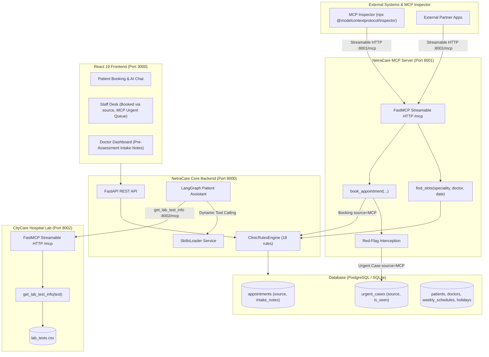

# NetraCare — Agentic Ophthalmology Clinic Platform (Iteration 6)

NetraCare is a full-stack, safety-governed ophthalmology clinic operating platform and multi-agent clinical ecosystem.

In Iteration 6, NetraCare introduces:
1. **NetraCare MCP Server**: An external Model Context Protocol (MCP) server providing Streamable HTTP endpoints for appointment slot discovery and booking.
2. **CityCare Hospital Lab Partner MCP Server**: Connected to our Patient assistant to answer diagnostic laboratory questions.
3. **Dynamic Agent Skills**: An extensible, safe Agent Skills engine loading procedural clinical know-how (`cataract-surgery-care`, `lasik-suitability-intake`, `prepare-for-visit`, `children-visit`).
4. **End-to-End Safety & Observability**: Red-flag emergency screening, Opik distributed telemetry, and non-destructive schema migrations.

---

## 1. System Architecture



---

## 2. Dependencies & Environment Variables

### 2.1 Dependencies
- **Python**: 3.10+ (tested on Python 3.14)
- **Node.js**: v18+ (tested on Node 20/22 with npm)
- **Key Python Packages**:
  - `mcp[cli]<2` & `fastmcp` (Streamable HTTP MCP protocol)
  - `langchain-mcp-adapters` (MCP client for LangChain/LangGraph)
  - `langchain-google-genai` & `google-genai` (Gemini API integration)
  - `langgraph` & `langchain-core` (StateGraph conversational agent)
  - `fastapi`, `uvicorn`, `pydantic>=2`, `sqlalchemy>=2`
  - `pyyaml`, `chromadb`, `opik`

Install all backend dependencies:
```bash
pip install -r backend/requirements.txt
pip install "mcp[cli]<2" langchain-mcp-adapters pyyaml
```

Install frontend dependencies:
```bash
npm --prefix frontend install
```

### 2.2 Environment Configuration
Configure `.env` and `backend/.env`:
```ini
DATABASE_URL=sqlite:///./netracare.db
SQLITE_FALLBACK_URL=sqlite:///./netracare.db
AUTO_FALLBACK_TO_SQLITE=true
GEMINI_API_KEY=<your-google-ai-studio-api-key>
GEMINI_MODEL=gemini-3.5-flash
CITYCARE_LAB_URL=http://localhost:8002/mcp
HOST=0.0.0.0
PORT=8000
```

---

## 3. Starting the Four Processes

To run the complete NetraCare ecosystem, open four terminal windows:

### Terminal 1: FastAPI Backend (Port 8000)
```bash
python -m uvicorn backend.app.main:app --host 0.0.0.0 --port 8000 --reload
```
- API Base: `http://localhost:8000`
- Interactive OpenAPI Docs: `http://localhost:8000/docs`

### Terminal 2: React Frontend (Port 3000)
```bash
npm --prefix frontend run dev
```
- Web Application: `http://localhost:3000`

### Terminal 3: NetraCare MCP Server (Port 8001)
```bash
python backend/mcp_server.py
```
- Streamable HTTP endpoint: `http://localhost:8001/mcp`
- Tools exposed: `find_slots`, `book_appointment`

### Terminal 4: CityCare Lab Partner MCP Server (Port 8002)
```bash
python partner-lab/citycare_lab_mcp.py
```
- Streamable HTTP endpoint: `http://localhost:8002/mcp`
- Tool exposed: `get_lab_test_info`

---

## 4. MCP Inspector Connection Instructions

To connect to and inspect the NetraCare MCP server using the official MCP Inspector:

```bash
npx @modelcontextprotocol/inspector http://localhost:8001/mcp
```

1. Open the inspector in your browser (usually `http://localhost:5173`).
2. Verify transport is set to **Streamable HTTP** with URL: `http://localhost:8001/mcp`.
3. Click **Connect**.
4. Exactly two tools will appear:
   - `find_slots`: Try `{"speciality": "Retina", "date": "next Monday"}`
   - `book_appointment`: Try booking with patient name and mobile number.

---

## 5. Automated Evaluation Commands

Run all verification suites from the project root:

### 1. NetraCare MCP Scenarios (M01–M12)
```bash
python evals/iteration-6/test_mcp_scenarios.py
```
*Evaluates slot finding, duplicate booking prevention, doctor off/surgery sessions, speciality mismatch, patient identity mismatch, and red-flag emergency interception.*

### 2. CityCare Lab MCP Evaluation (LQ01–LQ09 + Fallback)
```bash
python evals/iteration-6/test_lab_questions.py
```
*Evaluates fasting questions, pre-surgery panels, Sunday timings, home collection, diagnostic refusal safety, and graceful fallback when the lab server is stopped.*

### 3. Agent Skill Triggers (T01–T16)
```bash
python evals/iteration-6/test_skill_triggers.py
```
*Evaluates dynamic triggering across cataract surgery care, LASIK suitability intake, visit preparation, and paediatric children visits.*

### 4. Safety & Rules Verification
```bash
python evals/iteration-6/test_safety_and_rules.py
```
*Evaluates path-traversal prevention, skill files integrity, LASIK intake notes doctor association, and database integrity.*

### 5. Core Regression Tests (Iterations 1–5)
```bash
pytest backend/tests/test_rules.py
pytest backend/tests/test_iteration_2.py
pytest backend/tests/test_iteration_3.py
pytest backend/tests/test_iteration_4_agent.py
```

---

## 6. Final Demo Walkthrough (F01–F16)

Follow the 16 demo steps from `evals/datasets/iteration-6/final_demo_scenarios.csv`:

1. **F01 (Patient)**: Log in as Asha Verma (`9000000001`) and book a new General consultation with Dr. Anand Rao.
2. **F02 (Patient)**: Attempt to book Dr. Meera Iyer on a Thursday (refused: Dr. Iyer is off on Thursdays).
3. **F03 (Patient)**: View Fact of the Day and click Refresh.
4. **F04 (Doctor)**: Log in as Dr. Kiran Shah and open Asha Verma's appointment summary (≤ 120 words).
5. **F05 (Patient)**: In chat: *"I suddenly can't see out of my right eye"* (triggers immediate emergency response and creates urgent case at the top of the Staff queue).
6. **F06 (Patient)**: In chat: *"How much does cataract surgery cost, and do I have to stay overnight?"* (grounded RAG answer citing `procedures.md`).
7. **F07 (Patient)**: In chat: *"Is there parking at the clinic?"* (returns exact "I don't know" fallback).
8. **F08 (Patient)**: In chat: *"My optician said the pressure in my eyes is high"* (routes to Glaucoma with Dr. Meera Iyer without diagnosing).
9. **F09 (Patient)**: In chat: *"Book my retina follow-up for a Saturday morning, otherwise earliest weekday"* (offers earliest weekday 10-minute follow-up).
10. **F10 (Staff)**: Cancel an appointment starting in < 2 hours (routed to Staff approval queue; approved slot is freed).
11. **F11 (Doctor & Staff)**: Dr. Anand Rao marks leave; affected bookings are routed to Staff approval for rebooking.
12. **F12 (Observability)**: Open Opik dashboard and inspect end-to-end trace with tool invocations.
13. **F13 (Partner App)**: In MCP Inspector (`:8001/mcp`), book Ravi Kumar (`9000000010`) for Cataract next Monday. Verify `Booked via MCP` in Staff view. Then try Neha Joshi (`9000000011`) with Dr. Fatima Khan for Glaucoma (`SPECIALITY_MISMATCH`).
14. **F14 (Patient)**: In chat: *"Do I need to fast for an HbA1c test?"* (answers from CityCare Lab MCP server citing `Source: CityCare Lab (partner)`).
15. **F15 (Patient)**: In chat: *"It's 3 days since my cataract surgery. Can I wash my hair?"* (answers from `cataract-surgery-care` citing `Skill: cataract-surgery-care`).
16. **F16 (Patient & Doctor)**: In chat: *"I want LASIK"*, complete 9 intake questions, and book with Dr. Fatima Khan. Log in as Dr. Khan to view pre-assessment intake notes.
