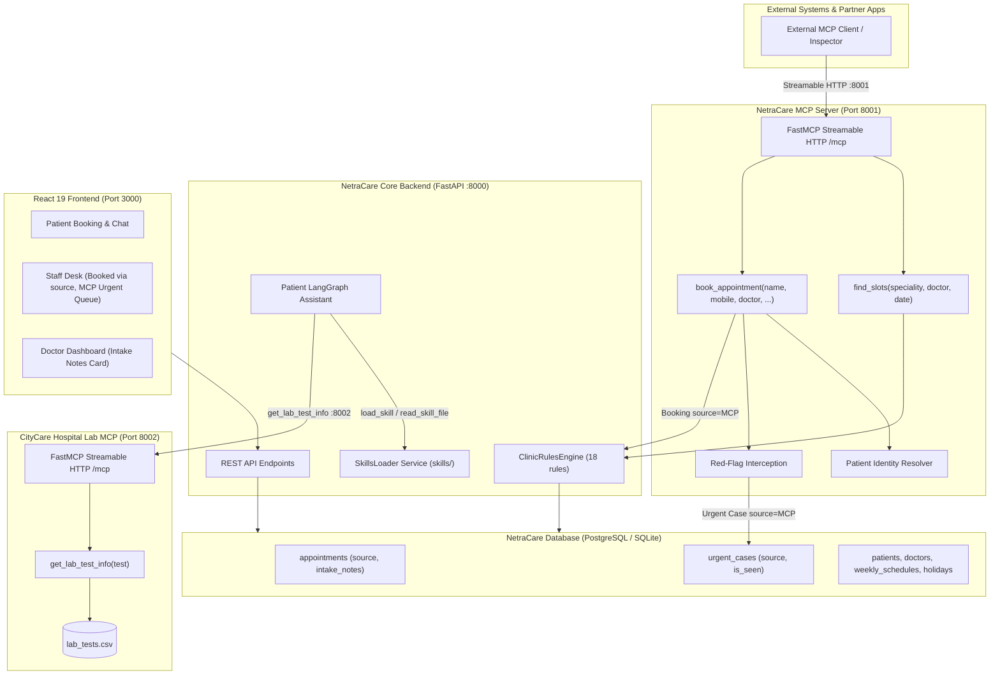

# NetraCare Iteration 6 — Architecture & System Design

## 1. Executive Summary
Iteration 6 extends the NetraCare Agentic Clinic Platform into an interconnected ecosystem through:
1. **Model Context Protocol (MCP) Server**: Exposing NetraCare clinic booking capabilities to external partner systems and AI agents.
2. **Partner Lab Integration**: Consuming partner laboratory information from CityCare Hospital Lab via MCP.
3. **Dynamic Agent Skills**: Equipping the Patient LangGraph assistant with modular, on-demand clinical procedure skills.
4. **Enhanced Safety & Observability**: End-to-end tracing with Opik, strict path-traversal safeguards, and red-flag emergency triage.

---

## 2. System Architecture Diagram

---

## 3. Core Components

### 3.1 NetraCare MCP Server (`backend/mcp_server.py`)
- **Protocol**: Model Context Protocol (MCP) 1.x using FastMCP with Streamable HTTP transport at `http://localhost:8001/mcp`.
- **Exposed Tools**: Exactly two typed tools:
  1. `find_slots(speciality, doctor, date)`: Returns up to 10 earliest available slots.
  2. `book_appointment(patient_name, mobile, speciality, doctor, date, start_time, reason)`: Books new consultation appointments.
- **Identity Resolution**: Resolves patient by mobile. New mobile registers a new patient; existing mobile with mismatched name returns `PATIENT_DETAILS_MISMATCH`.
- **Safety Interception**: Pre-booking red-flag screening. If an emergency is described, an urgent case with `source="MCP"` is created immediately, booking is blocked, and the exact emergency response is returned with reason code `RED_FLAG`.
- **Zero Logic Duplication**: Reuses `ClinicRulesEngine` directly. All appointments created have `source="MCP"`.

### 3.2 CityCare Hospital Lab Integration (`partner-lab/citycare_lab_mcp.py`)
- **Partner Service**: Runs independently on `http://localhost:8002/mcp` serving 7 lab tests from `partner-lab/lab_tests.csv`.
- **Assistant Integration**: Integrated into the Patient LangGraph assistant via `langchain-mcp-adapters` with a synchronous wrapper.
- **Rules of Engagement**:
  - General lab test information only (fasting, turnaround, indicative prices).
  - Never recommends tests, interprets lab values, or books lab tests.
  - Cites `Source: CityCare Lab (partner)` on answers using the partner tool.
  - Resilient fallback: If CityCare is unavailable, returns `"I can't check CityCare Lab just now. Please ask Staff at the front desk."` without crashing normal clinic chat.

### 3.3 Dynamic Agent Skills (`skills/` and `backend/app/services/skills_loader.py`)
- **Metadata Discovery**: Parses YAML front matter (`name`, `description`) at server startup and injects skill summaries into the Patient assistant system prompt.
- **On-Demand Loading**: Full `SKILL.md` instructions and supporting guide files (`post-op-guide.md`, `checklists.md`, `questions.md`) are loaded dynamically when relevant questions are asked.
- **The Four Skills**:
  1. `cataract-surgery-care`: Instructions before and after cataract surgery; references `post-op-guide.md`.
  2. `lasik-suitability-intake`: 9 sequential suitability questions; stores responses in `intake_notes` and routes to Dr. Fatima Khan.
  3. `prepare-for-visit`: Generates personalized visit checklists based on upcoming appointment records.
  4. `children-visit`: Authored skill for pediatric eye care with Dr. Vikram Menon; strictly grounded in clinic documents.
- **Security**: Strict path-traversal prevention blocks directory escapes (`../`, absolute paths, null bytes).
- **Citations**: Appends `Skill: <skill-name>` to turns utilizing skill documents.

### 3.4 Database Schema Updates
- Non-destructive migration preserves all existing Iteration 1–5 records:
  - `Appointment`: Added `source` (`VARCHAR(20)`, default `"Website"`) and `intake_notes` (`TEXT`, nullable).
  - `UrgentCase`: Added `source` (`VARCHAR(20)`, default `"Appointment"`).
- Priority ordering: Unseen MCP-origin urgent cases (`source="MCP"`, `is_seen=False`) are sorted to the top of the Staff triage desk.

---

## 4. Observability & Telemetry
- **Opik Tracing**:
  - Traces MCP tool invocations (`find_slots`, `book_appointment`).
  - Traces partner lab calls (`get_lab_test_info`).
  - Traces skill dynamic loading (`load_skill`, `read_skill_file`).
  - Captures execution latencies, input arguments, and error states without leaking sensitive patient credentials.
